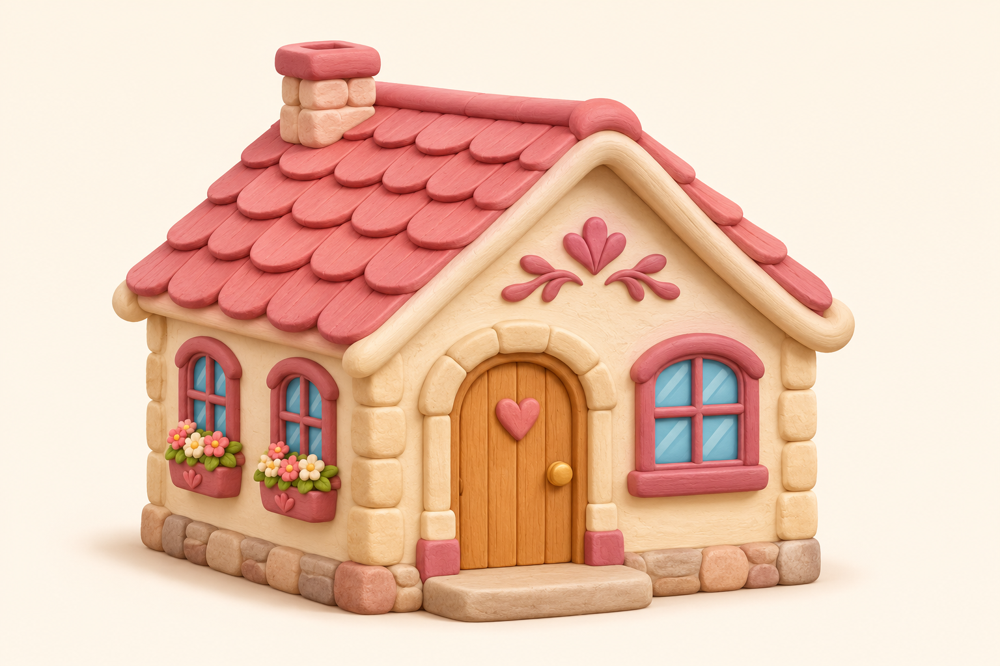
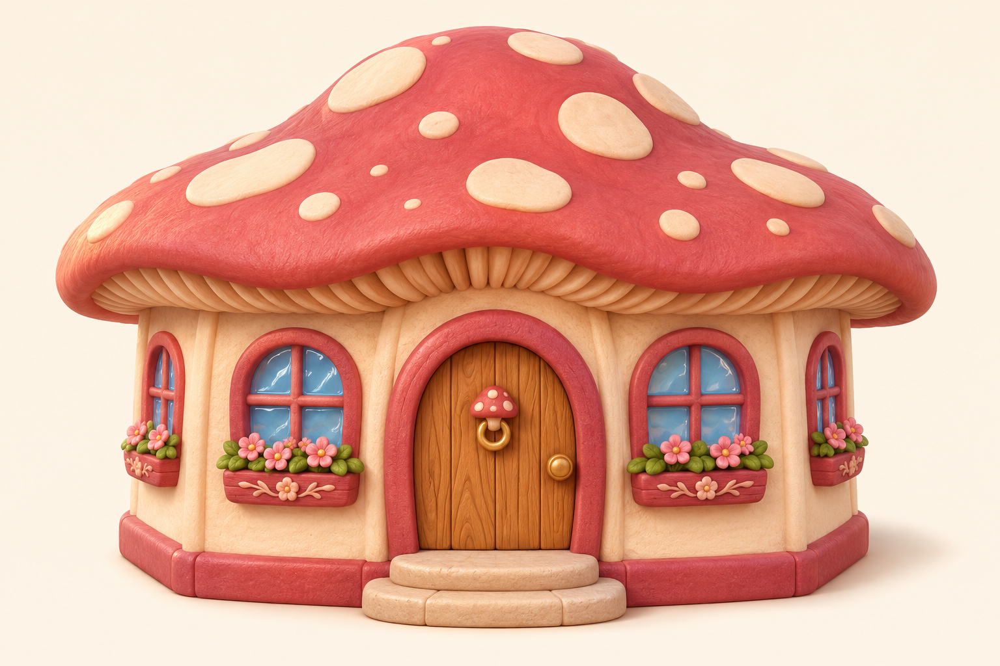
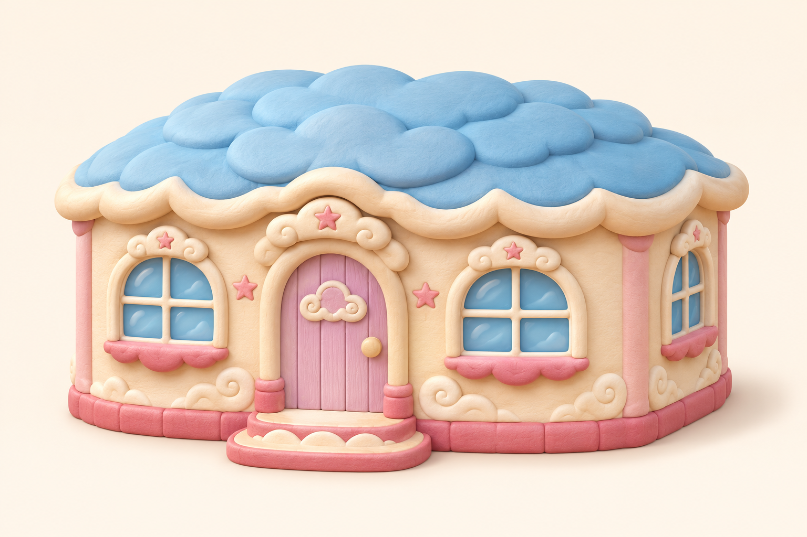
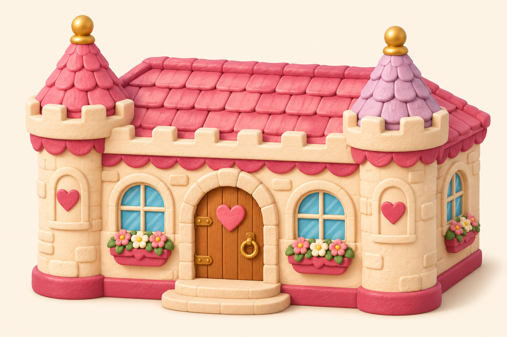
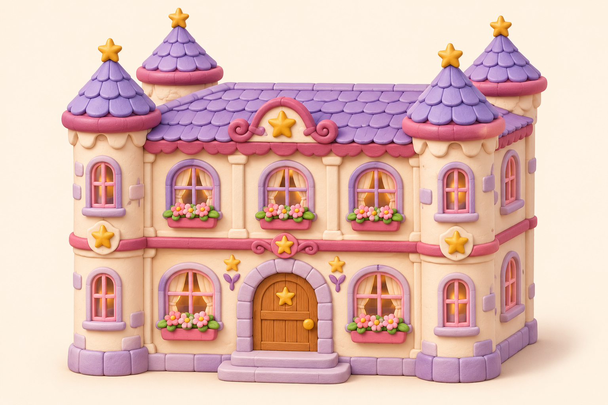
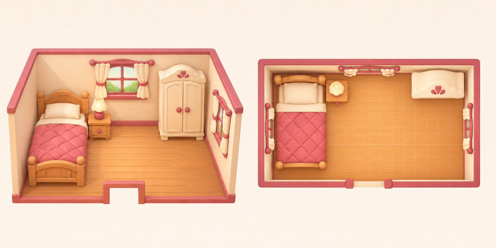

# 房型与室内美术方案 v1

2026-11-09，使用内置 `image_gen.imagegen` 制作。共12张选定PNG：五档房型、一张室内双视角概念板、四件独立家具及两张墙地材质候选。具体模型ID未由工具提供。

这批供选风格与制作三维资产使用，尚未接入游戏。原软陶人物、商店及莓红面板继续沿用。首批只覆盖五档房型和一间卧室样板，不能视为407件家具及全部房间素材已齐。

## 五档房型

采用一致的奶油墙、圆角厚边、柔和陶土质感和可辨识窗户。等级与ID沿用现有内容，不因图片重新发放房型或家具。

| 房型 | 解锁 / 真实空间 | 外观方向 | 原图 |
|---|---|---|---|
| 奶油小屋 `starter` | Lv1 / 一层两房 | 莓粉小瓦顶、爱心木门，作为入门小家 | [查看](house-starter.png) |
| 蘑菇小屋 `mushroom` | Lv3 / 一层两房 | 珊瑚粉蘑菇帽、奶油斑点、森林童话 | [查看](house-mushroom.png) |
| 云朵小屋 `cloud` | Lv5 / 一层三房 | 浅蓝云瓣屋顶、浅紫门、奶油波浪檐 | [查看](house-cloud.png) |
| 糖果城堡 `castle` | Lv8 / 一层四房 | 两座胖圆角塔、粉紫顶，仍是紧凑单层 | [查看](house-candy-castle.png) |
| 星光城堡 `star_castle` | Lv12 / 两层六房 | 双层窗、四座小塔、淡紫屋顶和金色星饰 | [查看](house-star-castle.png) |

### 奶油小屋

### 蘑菇小屋

### 云朵小屋

### 糖果城堡

### 星光城堡

外观图不是建筑图：窗户数量、塔体和屋檐装饰须适配真实蓝图，不能直接覆盖墙体、扩大可用房间或堵住开口。塔顶不额外产生房间，现蓝图没有楼梯。

## 室内两种用途

左侧用于欣赏房间与家具造型；右侧用于说明俯视摆放、通道和占地。床靠左、柜子靠右后、门在前侧中间，留出中心活动空间。

这是同一布置方向的概念板，非同一三维场景的精确双视图：斜视只画出两扇窗，俯视画出三扇；灯具和柜体细节也有生成差异。后续相机必须切换同一份真实空间，不能用两张图分别充当可操作房间。准确尺寸、门窗位置与相机行为见[制作规格](../../../docs/house-room-art-direction.md)。

## 单件家具与墙地

| 对应真实内容 | 原图 | 当前用途与限制 |
|---|---|---|
| 小床 `bed_basic` | [床](furniture-bed-basic.png) | 造型参考；宽光晕未清除，不作为干净透明图卡 |
| 床头柜 `nightstand_basic` | [床头柜](furniture-nightstand-basic.png) | 独立造型/图卡候选，台面留空；边缘尚待实底验收 |
| 台灯 `desk_lamp_basic` | [台灯](furniture-desk-lamp-basic.png) | 独立造型/图卡候选，与柜子分开；边缘尚待实底验收 |
| 衣柜 `wardrobe_basic` | [衣柜](furniture-wardrobe-basic.png) | 高家具造型/图卡候选；背面、顶部仍需真实模型补齐 |
| 奶油墙 | [墙面](material-cream-wall.png) | 候选颜色贴图；未做铺贴、UV或接缝验收 |
| 蜂蜜木地板 | [木地板](material-honey-wood.png) | 候选颜色贴图；未做铺贴、UV或接缝验收 |

家具原图有RGBA通道，但不表示抠图合格；三个柜/灯候选也可见局部彩边。它们与房间板属于同一风格系列，装饰细节尚未统一为精确模型。墙地没有配套法线/粗糙度图，不标作完整PBR材质。

庭院自然物沿用上一批[银杏树、圣诞树与棉花糖云](../soft-clay-v1/README.md)源图。近景可旋转树、体积云和可剖切房屋仍需真实三维网格。

## 记录与交接

- [manifest.json](manifest.json)：真实内容ID、用途、状态和源图追踪。
- [prompts.json](prompts.json)：完整生成提示词、房间视角编辑和未采用的床背景清理编辑。
- [inspection.json](inspection.json)：12张图的尺寸、通道、透明比例、文件hash及目视结论。
- [制作规格与素材覆盖](../../../docs/house-room-art-direction.md)：相机、米制尺寸、真实开口和接入验收。

本次只新增美术原图和文档，未改玩法、存档、账号、生产或本地活动版本。未将图片放入运行发布包，也未以资源生成代替浏览器验收。
