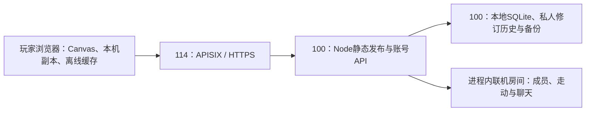

# 服务器网址与联机演进方案

日期：2026-10-29。关联：MC-038、MC-040、MC-041。状态：A网址服务、B账号SQLite自动存档，以及后续主界面可选登录与C邻居公开列表/只读参观均已实现并部署。该阶段正式HTTPS正常证书校验、入口/版本/健康及全部122份发布文件hash已通过，匿名列表/详情/参观与Chrome实际画面已验；独立验收账号重启后私人修订/hash与公开快照保留，撤下公开404且私档不变。随后授权的D实时串门与聊天也已实现并部署，正式HTTPS双账号与重启隔离已验；本轮MC-041在线邻居与直接串门亦已实现并部署，66脚本758组及正式HTTPS在线摘要、称呼、聊天、重启隔离通过。共同布置仍未实现。APISIX由用户配置，实时功能沿用同源HTTP长轮询，无新端口或代理协议。操作见[部署维护](runbook/deployment.md)与[后端说明](../server/README.md)。

## 已确认的首期

用户已选择「网址打开就能玩，各自保存进度」，并说明入口有 APISIX，可把游戏部署到另一台应用服务器；明确要求增加后端、本地SQLite、每个孩子独立账号、跨设备续玩、离线缓存和JSON备份。本文沿用用户的逻辑称呼：**114 是入口网关，100 是应用服务器**，具体地址与连接方式只作受控交接。

现已实现网站入口与可选账号。打开网址即可单机玩，登录并明确关联后自动同步；绘图和玩法仍在浏览器运行，本机保存先成功才上传完整JSON到SQLite。100运行本项目Node网站／账号服务，114的APISIX负责路由及入口HTTPS；正式HTTPS到应用的通路已实测通过。

后续追加范围现已实现并部署：主界面直接展示登录/注册或账号与同步状态，旁边提供「邻居小屋」；未登录仍可游玩并参观公开邻居。邻居页先显示实际主动加入的公开小屋，再显示其他孩子最近主动公开的快照；自己的发布/更新/撤下在单独页签管理，设置保留同步、冲突、JSON与本机副本工具。在线区含自己家里的成员，普通区排除本人并去重；该列表不枚举登录账号，私人自动同步不等于公开。

应用服务器已部署A/B/C/D，网关配置由用户维护，前次发布未读取或修改它；正式HTTPS入口、版本/健康、全部122份发布文件及公开API/参观已通过实际通路核对。APISIX的Route可关联Upstream；后续配置字段、插件和入口仍须按用户已装版本核对。[APISIX Route](https://apisix.apache.org/docs/apisix/terminology/route/)、[Upstream](https://apisix.apache.org/docs/apisix/terminology/upstream/)

用户最初要求先完成前后端和本地测试，随后追加授权部署应用服务器。已实现零第三方依赖Node网站后端、不可变release、激活／回滚、版本／健康检查、每账号SQLite自动存档、CAS冲突保护、账号切换本机副本、JSON备份与公开页面离线缓存。完整连接地址不写入项目文档；已通过既有SSH密钥连接并完成部署验收。实际接口和限制以[账号存档说明](cloud-save.md)为准。

## 四种能力的边界

| 阶段 | 用户得到什么 | 新增服务职责 | 是否自动互通进度 |
| --- | --- | --- | --- |
| A：网址访问，已实现并部署 | 打开网址玩；每个浏览器自己的小屋；可手动导入旧 JSON | 静态文件、HTTPS、版本发布和回滚 | 否 |
| B：可选孩子账号与云存档，已实现并部署 | 同一孩子跨设备继续；不登录仍能单机 | 会话、归属、版本化 JSON、冲突处理、备份恢复 | 同一身份下按整档修订同步，分叉需选择 |
| C：邻居公开列表／只读参观，已实现并部署 | 主人主动发布，网站访客从公开邻居列表或链接只读查看 | 白名单视觉快照、公开分页、本人发布/更新/撤下、独立参观入口 | 不合并两人的进度；展示上次主动发布内容 |
| D：实时串门与同屋聊天，已实现并部署 | 登录主动加入，看见同屋朋友走动并聊天，主人可请离 | 同源长轮询、认证成员、内存位置/短消息、限频和清理 | 不合并进度；房屋家具只读，私人云档不写入 |

网站托管、私人云存档、公开只读展示和实时多人分别有独立边界。A/B/C已实现并部署；D由用户追加授权，已实现并部署。共同布置需要另行定义共享房屋规则，尚未实现。

## 当前代码核对

| 已验证事实 | 实际位置 | 对方案的影响 |
| --- | --- | --- |
| 原生 HTML/CSS/JS、IIFE、`window.Game`，无构建依赖 | [入口](../index.html)、[约定](../AGENTS.md) | 可以直接发布静态文件，不需要改成 React 或 3D |
| 当前入口引用104 JS + 21 CSS，使用相对路径与内容指纹 | [入口](../index.html) | 源白名单为入口加125资源，共126文件；只读参观阶段101 JS + 20 CSS/122文件及账号阶段98 JS + 18 CSS/117文件保留为历史部署记录 |
| 当前版本 1、固定存档键，紧凑 JSON 同时限 3 MiB UTF-8 与 2,500,000 UTF-16 字符 | [balance](../js/data/balance.js)、[store](../js/core/store.js) | 私有云档可复用完整 JSON；账号、云修订号另存封套 |
| `store.update` 同步 clone→校验→可选本机 commit→发布事件 | [store](../js/core/store.js) | 保留本机事务，不能把同步 commit 换成异步网络请求 |
| 本机保存定时 30 秒、防抖 1.2 秒；游玩时间与居民也定时更新状态 | [save](../js/core/save.js)、[main](../js/main.js)、[systems](../js/systems/systems.js) | 同步adapter监听成功保存；操作防抖1.5秒，仅计时120秒合并 |
| 房间位置引用稳定房间 ID，实体、家具与居民引用分开 | [store](../js/core/store.js)、[room-layout](../js/systems/room-layout.js) | 可以复用布局，不用位置下标代替房间身份 |
| 个性化保存实际部件、两种 HEX、owned 和楼层引用，不保存额外模板身份 | [house-styles](../js/systems/house-styles.js)、[layout-templates](../js/systems/layout-templates.js) | 云档和展示都以实际外观／实体为准，不能靠模板 ID 重建 |
| 主场景读取全局状态并安装摆放、领奖等输入；参观路由在任何主人初始化前分支 | [scene](../js/render/scene.js)、[main](../js/main.js)、[visit](../js/ui/visit.js) | 独立文档只用白名单合成状态绘图，不替换自己的store，不加载主人存档/规则/同步/租约 |
| 实时adapter和联机hub独立于私人存档 | [live](../js/core/live.js)、[live-hub](../server/live-hub.cjs)、[实时合同](realtime.md) | 复用同源API与Cookie验证，位置/聊天仅内存；数据库schema、JSON和私档contractHash不变 |

评估开始时项目内未发现服务器部署配置、网关配置、域名、部署目录或可用SSH连接约定。用户补充了两机分工及目标地址，并要求先实现再部署；该评估阶段未尝试连接，当前部署见[维护手册](runbook/deployment.md)。初检预览为原Python PID94735，后续它退出后只恢复同一`127.0.0.1:4173`，由新后端提供游戏，不另外启动端口或浏览器进程。

## A：最小首期的部署方式

1. **固定站点 origin。** 优先分配独立子域名，入口HTTPS在114统一处理。100可运行本次实现的Node网站服务，进程托管沿用其实际环境，不额外预设Nginx、Docker或监听端口。100的入口只需对114的受信网络开放；若跨不可信网络，须增加上游TLS或安全隧道。
2. **限定发布文件。** 从 `index.html` 引用推导白名单，只发布入口、`js/`、`css/` 所需文件。排除父目录教学页面、文档、测试、`.impeccable/`、个人 JSON/MD、备份和 ZIP。将发布目录与数据库、日志、备份目录分开，关闭目录浏览。
3. **核对代理路径。** 确认 APISIX 转发的是子域名根路径，还是带尾斜杠的路径前缀；前缀是否剥离应与 100 的文件目录一致。逐一请求入口及活动清单中的全部资源（当前源入口为125资源），不能只测首页返回 200。未知静态路径应返回 404，不能把缺失 JS 返回为 HTML。
4. **版本资源保持不可变。** 本次后端已实现入口`Cache-Control: no-cache`、发布副本资源指向独立release目录、旧release保留及资源hash检查。源目录仍是`js/a.js?v=hash`，直接切换普通webroot软链无法保证请求不混版；发布工具仅改副本引用，不改变离线入口。激活后同data-dir固定basePath，错误前缀不能误切上线。[HTTP 缓存规则](https://developer.mozilla.org/en-US/docs/Web/HTTP/Guides/Caching)
5. **网关遵循同一缓存策略。** 确认 APISIX／其它缓存没有忽略版本路径或长期缓存入口。当前已加入固定release的Service Worker离线缓存，只缓存公开壳／资源；API必须no-store、不进入代理或worker缓存。安装完成前不承诺断网重开；更新等待旧页面关闭，不强制接管编辑中的页面。
6. **交付部署交接项。** 实施后记录不含敏感地址的服务名、release 标识、用户选定目录与回滚操作；向用户提供供 APISIX 配置的上游监听信息及路径约定。实际连接信息通过受控渠道交接，不写入公开项目文档。

localStorage 按协议、主机、端口构成的 origin 隔离；HTTP→HTTPS、localhost→正式域名、换浏览器都不会自动带来旧进度。同一 origin 的不同路径也不会隔离本项目的固定存档键。因此不建议把多个游戏副本仅靠路径分开。`file:` 存储行为还因浏览器而异，迁移应使用 JSON。[MDN localStorage](https://developer.mozilla.org/en-US/docs/Web/API/Window/localStorage)

**旧进度迁移：** 在原来的真实游戏页面，经「设置」新鲜导出JSON；在新网址先备份其已有进度，再经UI导入所选文件。核对经济、房间ID／位置、家具父引用／深度、居民、外观owned／HEX、领奖记录、花园、相册与画作，然后刷新及再次导出核对。不得用交接数字或过去备份覆盖今天的新进度。首期已修复本机拒写仍报导入成功的缺口，真实跨域迁移仍须按此核对。

**首期验收：** HTTPS与两机代理通路正常；活动release全部资源无加载失败（A历史版本112项）；桌面和手机可操作且声音需主动解锁；同一浏览器刷新保留进度，另一个浏览器有独立进度；旧JSON迁移后刷新可恢复；发布／回滚不改origin、不清站点数据、不混用release；静态目录不泄露存档、文档或备份。真实存档验收前后都须经UI备份与恢复。

网址版已提供离线缓存：HTTPS或loopback下，界面确认「离线副本已准备好」后可断网重新打开；只缓存公开壳与不可变资源，不缓存账号API。本机私有进度保留在localStorage，浏览器可能清理它，因此JSON备份仍保留；离线目录版仍可独立运行。

## B：已实现的账号与SQLite自动存档

每个孩子一个用户名／密码账号和一份完整小屋，不要求真实姓名或邮箱；当前不含家庭配对码、密码找回与管理后台。注册或首次登录时明确选择关联本机、恢复云端或为空账号新建小屋。guest与最多2个本机账号副本分开保存，配额／拒写会停止切换，先下载JSON。

Node.js 24.3.0内置SQLite保存账号、会话令牌hash、完整JSON、最多10个版本和256份幂等回执；数据库使用WAL和一致性备份，启动／每24小时／正常退出自动备份，保留7份。密码采用异步加盐scrypt，会话Cookie为HttpOnly/SameSite Strict；HTTPS启用Secure。API校验Origin、CSRF、账号归属、存档大小及可信源码validator，限流登录。JSON不会包含登录凭据。

同源`/api/v1`合同见[账号存档说明](cloud-save.md)，实际操作见[server说明](../server/README.md)。服务端验证客户端build／数据合同，不仅看JSON version=1。读坏档后生成的默认状态不能自动上传；旧档原文保留。CAS、历史与mutationId回执在同一事务提交，ETag包含epoch／revision／contentHash；重复请求不重奖、不重复增修订。备份灾难恢复前轮换epoch并撤销会话，避免旧修订身份复用。

本机成功落盘事件携带该次快照；普通操作1.5秒防抖上传，仅计时变化120秒合并，在线30秒轮询远端并在网络失败后退避。完整JSON包含原计时字段。不把pagehide当可靠云保存，离开设备前查看已同步或下载JSON。会话过期继续本机，重新登录后比较基准；迟到／乱序请求绑定账号、epoch与本机generation。多标签租约从store/save两处拦截旧页写入，支持明确接管。

本机或远端仅一边变化时自动续接；两边都改则保留双方并显示等级／钱包／房间摘要，用户选择继续哪一份、可下载双方JSON。不能按设备时间选胜负，也不逐字段合并金币、库存或领奖记录。这个能力是私人存档同步，validator不能证明离线数值未被修改；未提供排行榜或共享经济。跨设备音色取决于目标设备安装的语音。

账号阶段通过真实SQLite接口与两个隔离客户端验证连续游玩、分叉、离线重试、丢失回执／重复请求、账号切换、版本／epoch和越权保护；同一Chrome原页完成注册、独立初始小屋、自动保存、刷新与停服务离线重开。本轮正式HTTPS/APISIX实际通路另已通过；两个物理设备、Safari、长期使用与异机灾备恢复仍未验，规则与VM客户端检查不冒充这些结果。

## C：已实现并部署的邻居公开列表与只读参观

用户选择的首期是邻居列表和只读参观，优先展示其他孩子主动公开的小屋。默认私密；登录并关联后，主人填写1–24字公开小屋名与展示昵称并确认，再先同步私人进度，由服务器按expectedRevision从本人当前已验证云档生成独立白名单快照。展示昵称默认通用称呼，不自动取账号名。公开API仅按最近公开更新时间分页列出公开记录，每页最多24份，不枚举私有账号；无需登录即可参观，能访问网站的人都可能看到已公开内容。

自己公开的状态在独立页签管理；自动云存档不改公开快照，主人可主动更新或确认撤下。撤下后列表和原链接后续获取均失败，私有进度保留；重新发布生成新公开ID。发布/更新遭遇云revision变化返回412，需要重新同步并确认。完整API和客户端边界见[公开小屋合同](public-neighbors.md)。C的生产阶段为只读参观；随后增加的在线在场与聊天见D，交易与共同布置尚未实现。

| 公开视觉投影 | 处理方式 |
| --- | --- |
| 当前屋顶／墙／窗／门／烟囱及 roofColor／wallColor | 复用具体 ID 和 HEX，不用风格配方 ID 重建；不公开 owned 字典 |
| `house.floors[].slots`、`house.rooms` | 保留稳定实体 ID、房型与实际位置；只投影装修和物品视觉字段，排除 paidPrice 等经济字段 |
| 摆件 uid／defId／x／y／parent／depth／z／flip／color／artId | 保留 canonical 坐标及台面父子关系，不能传屏幕投影坐标代替 |
| 墙纸、地板、灯光、自制挂画与墙纸 | 仅附实际引用的画作ID／16×16像素；画作名称与照片配文不公开，公开房名另经主人确认 |
| 前院与阁楼 | 只取已建状态与视觉字段，不取收费、观星和奖励凭据 |
| 玩家及入住居民 | 当前形象、角色ID与房间引用；不带衣橱拥有权、好感、生日、心愿或领取历史 |

完整profile、账号ID/账号名、钱包、库存、回忆、相册／回收夹及其配文、领奖历史和设备设置均不进入展示响应；公开房名与展示昵称等文本使用白名单和textContent。服务器不接受客户端公开JSON或owner字段。公开投影另由可信release脚本生成，不改变私人存档contractHash，既有私人save/history/session接口兼容。

独立viewer在`basePath+/visit/:id`文档中获取快照，materialize严格校验后构造并冻结绘图合成状态，复用离屏captureScene，提供整屋/房间、拖动/缩放与返回自己的小屋。main在cloud.prepare、save.load、store.init、规则、同步与租约之前分支，参观页不初始化主人编辑输入、自动保存或每日／经济系统，不把朋友档store.replace到自己的小屋。D的成员/聊天由独立adapter接入此页，主人也在此隔离文档加入。参观导航和公开API不缓存，断网不会退回主人入口。本地规则与实际浏览器已检查参观不写本机存档、云修订不变及越权请求拒绝；C的生产匿名列表/详情/参观与Chrome实际画面已验，独立验收账号的快照重启后保留，撤下后公开404且私档不变。

## D：已实现并部署的实时串门与同屋聊天

用户随后明确要求互相串门、看到彼此走动并聊天。主人点「在我家一起玩」，朋友点「去串门」，均进入独立`/visit/:id`页，登录后主动填写展示昵称并加入；未登录仍可只读参观。每屋最多8人，在线形象由服务器从本人已验证云档白名单生成，无云档用可信默认形象，不公开账号名。房间选择只改变观察范围，进入按钮才移动自己到该房间；之后点击地面、键盘或方向控件走动，其他成员平滑跟随。房屋家具保持公开快照的只读状态。

同源`basePath+/api/v1/live/*`使用最长8秒的HTTP长轮询，有事件立即返回；复用现有端口、Origin、协议/build及no-store，不要求WebSocket或代理升级。`server/live-hub.cjs`保存最多64屋/256成员，成员TTL35秒、有效轮询/动作续期，一个账号只能有一个在线成员。`X-MC-Live`绑定Cookie，加入后的`X-MC-Peer`绑定本次成员，POST另验CSRF；跨账号、旧标签或迟到请求不能作用于新成员。移动最多5次/秒，聊天有限频与幂等ID；所有数据不进入SQLite、私人存档或日志。

聊天为1–80字纯文字与4条快捷短句，只交付本次加入后的消息，服务器最多保留32条内存消息。屏蔽只隐藏本次串门中的对方聊天；主人可请离成员并在本次房间生命周期禁止其重加。更新或撤下公开模样立即结束对应联机房间；退出/换账号、会话过期或epoch变化清理成员。后台停止轮询/移动，返回验证原成员；TTL到期、被替换或服务重启后须主动重新加入，不自动补发聊天或恢复成员。关闭服务先释放等待请求，再关闭HTTP/SQLite。完整API、状态机和绘图接口见[实时合同](realtime.md)。

本地65脚本732组及Chrome与独立HTTP客户端已验证两个形象、双向移动/聊天、明确进入房间、屏蔽/取消屏蔽与主人请离后的403禁止重加，两方私人云修订/hash不变。最终另有57组定向复查通过。实时版已部署，正式HTTPS双账号加入、走动与双向聊天、形象白名单、长轮询事件唤醒、访客不能请离主人、主人请离后409/禁止重加403均已验。重启前等待请求以503释放，重启后旧peer失效、主动重加产生新peer且聊天不恢复，私人修订/hash及公开快照保留。当前126份发布文件与新发布身份见部署手册，上一阶段122文件验收保留为历史。共同布置、共享经济、交易、私信和音视频均未实现；未来若增加共同编辑，仍需另行定义服务端权限、事务、冲突与恢复规则。

### MC-041：在线邻居与直接串门（已实现并部署）

公开`GET /neighbors/online`将实际主动加入的成员按小屋分组，仅返回公开小屋摘要与`online:{count,hostOnline,displayNames}`，不枚举登录账号或私人小屋，也不返回peerId、形象、位置或聊天。先清理TTL、失效会话及更新/撤下的小屋，读取不续期；最多64屋、每屋1–8人，按有空位、屋主在场、人数降序、公开updatedAt/id降序排列。旧公开分页/游标合同保持。

列表打开、处于列表页签且文档可见时每10秒刷新在线区，返回立即刷新；关闭/后台/离页停止，generation隔离迟到结果。失败保留上次摘要并标明过期，移除在线标识和快捷加入动作；普通参观仍可使用，发布表单和链接焦点不因刷新重建。

有空位且新鲜的在线条目以`/visit/:id#join`表达本次明确加入意图；已登录且可见时尝试一次，游客只读，满员/过期只提供普通参观。`GET /live/me`仅认证本人新增`joinDisplayName`，优先当前实际在线的公开称呼，再取本人公开小屋昵称，最后「小小建筑师」。快捷加入重新握手，称呼和凭据绑定同一次Cookie，不取账号名或旧probe结果；消费精确片段后失败、离开、刷新及BFCache返回不重试。SQLite schema、私人存档API与离线/JSON保持；本轮66脚本758组串行检查已通过，合同见[在线邻居](online-neighbors.md)。

本轮已更新既有服务器，正式HTTPS全部126文件hash、在线人数1→2→1（屋主离开）→0、公开称呼/快捷称呼和双向聊天通过。重启清空在线、旧peer409、会话/公开快照/私人修订/hash保留及主动重加已验，原8张表内容和schema保持，两个验收账号已清理；服务运行且启用开机启动。发布身份与完整证据见[部署维护](runbook/deployment.md)和[验证记录](verification.md)。

## 运维成本与恢复

| 阶段 | 主要成本 | 控制方式 |
| --- | --- | --- |
| A | 文件分发、证书、入口可用性、release 留存 | 复用 114 网关与 100 静态服务；无逐帧服务器计算；备份发布文件／配置 |
| B | 一个 API 进程、本地磁盘、会话维护、同步流量和恢复演练 | JSON 快照去重、合并上传、限制留存、备份告警；SQLite 不需单独数据库守护进程 |
| C | 展示快照／可选图片、访问控制与只读渲染开发 | 默认不带相册，按版本发布；撤销后停止访问，旧内容留存受控 |
| D | 有界长轮询、内存成员/短消息、TTL清理与并发验证 | 8人/屋、64屋/256成员、限频与单成员等待；重启主动重加，先验收后扩容 |

按此前版本实测，100 次完整冷加载约分发 113 MiB 未压缩静态内容，实际取决于资源版本、压缩和缓存。云档按最坏每份 3 MiB 估算，20 个孩子各留 10 份约 600 MiB 原始快照，尚不含数据库开销与外部备份；若每分钟全量上传、每人玩 30 分钟，同样 20 人可产生约 1.76 GiB 上传量。因此容量主要受相册、留存和上传频率影响，不能仅按人数估算。以上为算例，不是服务器性能实测或费用报价。

已有服务器是否需要额外费用，取决于磁盘、流量、域名和备份额度；当前没有规格或账单，不建议先买新服务。B增加了账号与故障恢复验收，C增加独立只读渲染和公开边界，D增加有界内存房间、认证生命周期和并发处理；不能把「上传静态文件」估时套给联机开发。

B当前保留最近10个有效版本及7份一致性备份（并非严格每天一份）；同内容不无限新增版本，恢复前本机分支保留。规模与相册容量增大时再调整。数据库用一致性备份 API／快照方案，不能只随手复制正在写入的主文件。备份加密后保存在另一故障域，应用密钥与备份分开管理，并定期在隔离副本恢复。[SQLite Backup API](https://sqlite.org/backup.html)

A 回滚切回旧入口／release，保持同一 origin 和存档键，不清 localStorage。未来 schema 有变化时，先备份数据库与导出 JSON，只回滚到可读取当前档的代码；不可用旧代码强行打开未来档。云端历史恢复写成新修订，通知在线设备重新比较基准，不能回拨修订号后让旧设备无条件覆盖。

SQLite从旧备份做灾难恢复时，revision和幂等记录可能一起回退。启动对外服务前必须rotate-epoch，生成新的serverEpoch并纳入ETag／同步基准，撤销全部会话、旧幂等回执和公开记录/链接，避免已发过的修订身份被复用，也避免从旧备份复活已撤下的公开状态。恢复后所有设备重新登录取基准，保留尚未同步的本地分支；主人核对恢复进度后需主动重新发布。旧ETag不能通过比较，备份之后的未同步本地操作仍可能只有设备拥有，云端不能承诺恢复这些内容。

## 下一步与缺口

A/B/C已实现并部署应用服务器，系统／运行时／专用服务／监听／持久目录与账号/公开快照重启持久化均已核对。此前只读参观发布先完成旧代码一致性备份、停服务新增publications表，user_version仍为1，原有7张私有表内容hash核对不变；随后更新程序与release。APISIX由用户配置，该阶段正式HTTPS正常证书校验、入口/版本/健康及全部122份发布文件hash已通过；此前证书失败仅为旧阶段记录。生产地址、密码／私钥不写入文档，详细过程见[部署手册](runbook/deployment.md)。

当前没有密码找回；同盘自动备份不代替外部灾备；SQLite单实例使用本地磁盘，不放多机共享盘。以后部署还需核对网关IP限流策略，不盲信X-Forwarded头。C的访客隔离、公开/撤下与越权边界已本地验证，正式HTTPS公开流程及重启持久化也已验；两个物理设备、Safari、长期使用与异机灾备恢复仍未验。D已完成本地和既有服务器正式HTTPS的双账号验收；发布前旧代码一致性备份、停止服务后更新程序/release，服务以mc-cottage用户运行并启用开机启动。原8张数据库表内容hash、user_version=1、私人存档合同均保持，当前126份发布文件；发布身份和重启证据见部署手册。

## 验证记录

A首期曾完成48脚本560组、112资源与实际HTTP边界检查。B账号阶段新增SQLite、双客户端、同步状态机、账号UI和离线worker验证；C追加后本地60脚本674组及实际发布、列表、参观、撤下、退出流程已验，正式HTTPS的122份发布文件、匿名公开流程、Chrome画面及独立验收账号重启持久化另行核对。D本地65脚本732组、最终57组定向复查及真实Chrome与独立HTTP客户端流程已验，正式HTTPS另完成双账号互通、权限/请离隔离和重启后主动重加验收；当前最终数量、最新定向检查、浏览器证据及限制统一见[验证记录](verification.md)。所有Node规则检查串行、HTTP替身测试不启动监听；本地预览始终仅同一loopback4173、复用Chrome页。
