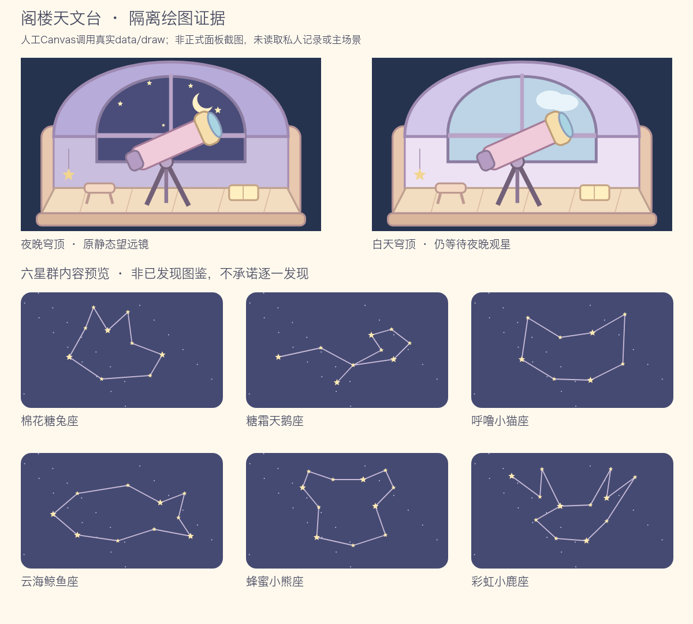

# MC-062 现有阁楼天文台面板升级

日期：2026-10-30（Asia/Shanghai）。交付范围为独立观星面板源码和隔离验证；不代表当前4173、正式发布或真实设备已载入新面板。交付后停止产品写入，由总集独立验收和维护共享TODO。

## 实际限定改动

| 文件 | 本次内容 |
| --- | --- |
| `js/ui/observatory.js` | 夜蓝穹顶与暖纸最近记录布局、真实状态文案、当前行动重读、错误保留/重新读取、局部会话/焦点/RAF/Canvas清理。原 `open/panel/entry` API保留，entry函数实现未改。 |
| `css/observatory.css` | 仅observatory专属选择器，保留原class；桌面并列、620px及以下先图后状态/行动，长数字换行、48px按钮、焦点与滚动条。 |
| `tests/observatory-visual-ui.cjs` | 内存DOM、合成档案与真实规则/保存API的27组隔离检查。 |
| `tests/observatory-visual-ui-png.cjs` | 仅真实data/draw的人工Canvas绘图、PNG编解码与非空像素检查，共2组。 |
| `tests/observatory-visual-ui-art.png` | 1200×1080静态绘图证据，含日夜穹顶和标为“内容预览”的六星群。 |
| 本报告 | 交付范围、验证结果与证据限制。 |

未修改prototype、共享README/TODO/交接、data/core/systems/render、公共UI/CSS、scene、其他批次、普通家园建造、屋顶几何/点击入口/镜头、入口资源指纹或发布快照。第一批完全排除；没有给第一批分配工作、发消息、修改或验收。没有新增服务/端口/浏览器进程、读取私人档案、操作真实账号、制作zip或部署。

## 最终行为

面板只展示今夜状态、累计碎片/次数与最近一条 `lastDiscovery`。未添加六类发现史、图鉴、计时/连线玩法、兑换或新奖励；正式面板没有六星群预览列表。最近记录的名称、故事和点位直接取真实 `constellationById`，日期与碎片取 `sys.observatory.latest()`，重看不调用观测。

| 真实状态 | 面板呈现与行动 |
| --- | --- |
| 等级不足 | 明确Lv.17开放，主行动不可用。 |
| 等级够但糖果不足 | 原系统差额说明，明确需1,000糖果，不调用build。 |
| 可建造 | 调用原 `sys.observatory.build()` 一次；独立阁楼不占普通格、不增加普通建房数。 |
| 白天/黄昏 | 不能观测；“去设置夜晚”只导航原settings，不修改设置。 |
| 可观测 | 调用原 `sys.observatory.observe()` 一次；成功才播成功音效与toast。 |
| 同日已观测 | 显示今天已领取，须更晚本地日历日期且夜晚才能再观测。 |
| 设备日期回拨 | 独立说明当前日期早于已保存日期，不混为普通同日领取。 |
| 达到上限 | 完整显示999,999,999碎片/333,333,333次；不能观测，最近记录可回看。 |
| 保存/同步失败 | 保留原API失败说明，按最新status恢复可用行动，不播放成功反馈。 |
| status/latest/API读取或同步异常 | 暂停未知行动，保留错误，提供“重新读取状态”。 |

规则仍由原系统负责：真实夜晚20:00–06:00或永远夜晚；当前本地日期必须严格晚于lastDate。午夜后若仍在夜晚可以再次观测，不按滚动24小时或早6点重置；漏日不补。每次3碎片、次数+1，fragments=observations×3，无糖果/经验奖励；星群按日期固定、可重复遇见，不承诺逐一发现。

没有修改既有 `store.update(...,{persist:true})` 同步提交和系统busy防重入，也没有扩大普通 `store.update` 的保证。UI点击前重读status/latest、只调用一个原API；失败后重读恢复按钮。实际setItem拒写时钱包、观星机会、碎片、原存档和成功事件均保持。

## 生命周期与可读性

- 局部session、档案代次、宿主kind/hidden/runtime及DOM归属共同拒绝旧按钮。关闭后抽屉即使仍连接DOM也不能写入；同步调用期间关闭/换档的迟到结果不能向新面板反馈。
- 成功局部更新，不再次open观星面板，避免产生额外镜头导航。宿主原有state/time刷新保持。
- 每次更新只安排单次RAF，继续调用原 `draw.observatory.draw/drawConstellation`；关闭/换档/旧面板清RAF和Canvas尺寸，无新增持续绘制或计时器。返回前台重读当前日期。
- action/settings/retry/feedback/status使用稳定 `data-ui-focus`；原行动不可用时焦点落到反馈或状态说明，连续刷新仍保留。局部刷新恢复抽屉scrollTop，焦点使用preventScroll。
- 正文14px、辅助12px、标题18–21px、48px行动目标；夜蓝`#26334f`配暖纸`#fff9ed`，正文`#41445c`，夜间正文`#fff5df`，主要按钮`#f5deb0`配夜蓝文字。错误`#674847/#ffe9dc`、成功`#394e43/#eff7e7`。测得正文/反馈/按钮11组前背景文字色对比度均至少4.5:1，仍不代替正式浏览器逐色/读屏验收。

## 实际验证

Node检查串行运行，只运行本批新UI/必要隔离绘图及原观星13组，没有运行全量或第一批scene检查。

| 命令 | 最终结果 |
| --- | --- |
| `node tests/observatory-visual-ui.cjs` | 27组通过。 |
| `node tests/observatory.cjs` | 原13组通过，原文件未修改。 |
| `NODE_PATH=<已提供的bundled node_modules> node tests/observatory-visual-ui-png.cjs` | 2组通过；PNG已解码并目视检查。可用 `OBSERVATORY_CANVAS_MODULE` 指定现有canvas模块，`OBSERVATORY_FONT` 指定本地中文字体，无新增依赖。 |

最终合计 **42组**。UI覆盖Lv不足/缺糖/可建、真实日夜边界、设置导航、观测单次与重入、同日/回拨/跨午夜/漏日、六真实内容与仅最近记录、两计数上限、build/observe真实setItem拒写及恢复、最新status恢复行动、status/latest/API异常、错误跨刷新保留、旧按钮/关闭/换档/迟到结果、宿主延迟事件、焦点/滚动与静态绘图清理。

只读子代理发现“按钮不可用后焦点落状态说明，后续重建会丢失”的P2；已给状态说明稳定焦点键，并加连续两次重建回归。子代理最终结论 **accept**，未修改文件或运行测试。这个accept只覆盖源码与隔离检查，不扩大为正式整页/设备验收。

impeccable机械扫描只运行一次，共53项advisory：35颜色、4圆角、14字号未收录于共享DESIGN说明。以上为本面板按明确夜蓝/暖纸交接采用的局部实值，已记录用途；未修改共享设计文件、增加忽略规则或再次扫描。无硬错误；扫描结果不作为视觉/无障碍完成证明。

## 证据及待验边界

已有4173监听继续复用。只读HTTP检查发现根页面仍指向旧 `r-383bb1dcf39ed44421f2e331428aa5a297e6a5c19a976793096f89e0049a7cc8` 发布资源：观星UI版本 `cb838ecae7` 与改动前文件完全相同，专属CSS仍为 `81feaff83e`；新源码未实际生效。直接源码路径 `/js/ui/observatory.js` 返回404。未改入口或切换release绕过。

因此，**正式桌面、390px、键盘焦点遍历/读屏、抽屉真实滚动、触屏/物理设备与实际穹顶取景均待后续目标快照加载后验**。本次内存DOM只验证事件/状态与可观察焦点逻辑，CSS静态检查不代表浏览器实际布局；人工Canvas图片只证明真实data/draw插图，没有载入scene/UI或私人记录，不能冒充主场景或正式面板截图。

TODO本轮未新增、移动、完成或重排；共享TODO与正式集成后待验项由总集维护。
