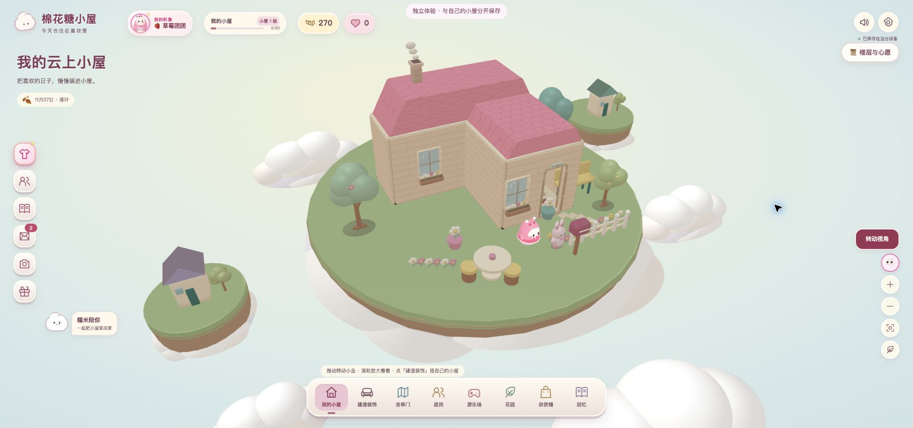

# 窗户、树与云的场景细化

2026-11-07，按用户“小屋没窗户，树和云能更好看些”的反馈细化，保留原人物、粉红莓红界面与所有面板。

## 窗户

此前体验存档有一扇真实窗，位于左侧x=-3墙，默认镜头从右前方看，整座房体遮住该窗；可见的正面与另一侧原先无窗。经原建造面板，在两个可见墙面各点击安装一扇真实窗，当前体验共3窗1门；新窗带花台。实际撤销开口数4→3、重做3→4，点击保存后载入新版仍为4，糖果270保持。

渲染中浅蓝玻璃透明度从0.19调整为0.55并增加细小高光，远景也能辨认；实际挖洞与双面窗框保持。花箱朝向改为在每个开口中心判断，避免长墙跨过不同空间时沿用整墙中点产生反向。没有改schema、默认创建规则或加载时给其它存档自动补窗。

## 环境资产

环境树采用深叠、大小不同的圆润树冠，可见分叉与根颈，前景分别点缀粉花、奶黄果；花果放到树冠表面，默认视角也可见。显式环境款式只用于本岛与远岛，原花园树类作物阶段保持。

散云与岛下云托采用连续宽轮廓和较平滑几何，加入轻微冷暖层次；云使用独立柔和受光材质，不接收或投射重阴影，避免褐色地面反照将其染成土块。草坪、土层、落脚范围和场景30fps/后台停绘机制保持；没有新引擎、外部图片或网络资源。

## 验证

- `npm run build`类型检查及同源IIFE构建通过；修改渲染后`npm test`全部37入口串行通过。最后一批仅调整环境树的配色、花果表面位置，再次构建通过。
- 原4173与同一Chrome页实际完成两扇安装、撤销、重做、保存、载入新版本；默认镜头两窗及花台清晰，云更白更软，树冠和花果可见。控制台error记录为空。
- CSS390×844窗口模拟再次核对，页面无横溢、窗仍可辨认；临时viewport覆盖已恢复。Chrome缩放80%，截图API带额外空白，不冒充物理手机或精确390像素截图。
- 本次对三份渲染/资产源码运行一次设计扫描，仅1条未登记颜色建议；未据此改掉既有配色或抑制规则。该扫描不是场景像素或计算对比度验证。
- 独立只读截图复核建议ship，未发现新增遮挡或视觉阻断；这不表示用户已认可效果。

准备版本`r-24f0eafe99fbf6974f360546f2c3d2fa4148fd2de9c4c04bd5eb003255eb4b67`，129发布文件，未激活普通入口、未重启服务或部署生产。真实账号/私人存档未操作。[打开独立体验](http://127.0.0.1:4173/offline-shell/r-24f0eafe99fbf6974f360546f2c3d2fa4148fd2de9c4c04bd5eb003255eb4b67?review=1)。当前体验里补装的窗保存在本浏览器的独立体验键；源码保留自由安装能力，不打包固定示例存档。

窄屏证据：[窗口模拟截图](screenshots/window-tree-cloud-20261107/home-mobile.jpg)。
